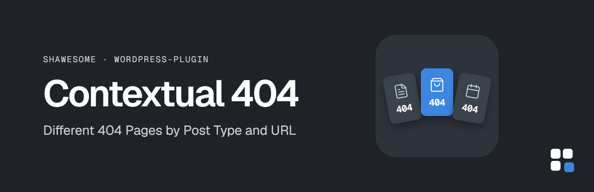

# shawesome Contextual 404 – Different 404 Pages by Post Type and URL

Shows a different 404 page depending on the requested URL: by post type, by taxonomy or by your own path rules.

By [shawesome](https://shawesome.de/) · Open source under the [GNU General Public License v2 or later](LICENSE).

## How it works

404 pages are a post type of their own, edited with the block editor or Elementor. They have no public URL and are not part of the sitemaps of WordPress. The page of a request is resolved in this order:

1. **Path rules** – a prefix or a regular expression, maintained in the admin
2. **Query vars** – the post type, taxonomy or date the rewrite rules recognized
3. **URL prefixes** – the rewrite slug or the archive of a post type
4. **Parent pages** – URLs below an existing page belong to the post type Pages
5. **Default** – the page selected as the default, otherwise the 404 page of the theme

With the permalink structure `/%postname%/`, a URL such as `/xyz` does not reveal whether a post or a page was requested, so the default applies.

The main query is replaced by the 404 page, so that themes and page builders render it like any other page. The status stays 404, the response carries `X-Robots-Tag: noindex`, and while the `<head>` is printed the query reports a 404, so that SEO plugins handle the request as an error page.

## Statistics

404 errors are counted per month, by the path rule or post type that applied, otherwise as "Default". A dashboard widget shows a pie chart of the current month, the tab *404 Log* shows the last 12 months, together or one by one, with the most frequent URLs.

A table holds one row per month and URL with a counter, so repeated errors do not add rows. Only the percent-encoded path is stored, without query string, IP address, user agent or referrer. A month holds up to 1,000 rows; beyond that, new URLs are only counted by category. Older months are deleted. Counting can be switched off and the statistics can be deleted in the settings.

## WPML and Polylang

404 pages are translatable. The translation in the current language is shown, language prefixes are not part of the paths in the rules, and the language switcher leads to the home page of a language.

## For developers

- Filter `shawesome_c404_page_id` – change the 404 page of a request
- Filter `shawesome_c404_log_limit` – number of rows a month holds
- Table `{prefix}shawesome_c404_log` – statistics
- Template `single-shawesome_404.php` in a theme – replaces the page template for 404 pages
- Option `shawesome_c404_settings` – assignments and path rules
- Admin menu `shawesome` with its start page – shared by all shawesome plugins, see [shawesome-wordpress-admin](https://github.com/shawesome-code/shawesome-wordpress-admin)

## Requirements

- WordPress 7.1+
- PHP 7.4+

The interface is in English. Translations will come from [translate.wordpress.org](https://translate.wordpress.org/) once the plugin is listed in the directory.

## Installation

Copy the folder `shawesome-contextual-404/` to `wp-content/plugins/` (or upload it as a ZIP) and activate the plugin. See [`readme.txt`](shawesome-contextual-404/readme.txt) for FAQ and changelog.

## Repository layout

- `shawesome-contextual-404/` – the plugin (translation template in `languages/`, shared admin code as a git subtree in `includes/shawesome-wordpress-admin/`)
- `.wordpress-org/` – plugin directory assets (banners, icons)

## License

Copyright © shawesome.

This program is free software; you can redistribute it and/or modify it under the terms of the GNU General Public License as published by the Free Software Foundation; either version 2 of the License, or (at your option) any later version. See [LICENSE](LICENSE).
